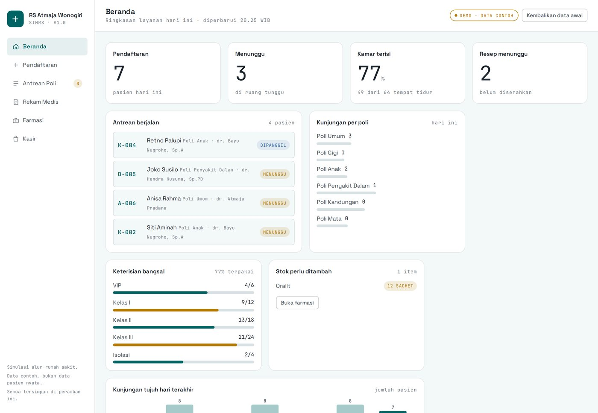

# SIMRS Atmaja — RS Atmaja Wonogiri

Sistem informasi rumah sakit untuk alur rawat jalan: pendaftaran pasien, antrean
poliklinik, rekam medis, farmasi, dan kasir. Satu halaman, berjalan di peramban,
tanpa peladen.

[**Buka aplikasi →**](https://atmajadesna.github.io/simrs-atmaja/)




> **Catatan penting.** Ini simulasi alur kerja, bukan sistem produksi. Seluruh pasien,
> nomor rekam medis, dan tagihan adalah data contoh yang dibuat sendiri. Tidak ada
> koneksi ke BPJS, SATUSEHAT, atau basis data rumah sakit mana pun.

## Latar Belakang

Di rumah sakit, satu pasien rawat jalan melewati lima meja: pendaftaran, ruang tunggu
poli, ruang periksa, farmasi, dan kasir. Kalau tiap meja punya catatan sendiri, yang
hilang biasanya bukan berkas medis, melainkan **hubungan antar mejanya** — nomor antrean
yang tidak nyambung dengan tagihan, obat yang sudah diserahkan tapi stok belum berkurang.

SIMRS Atmaja menyusun satu alur yang saling terhubung: setiap pendaftaran membuat nomor
antrean per poli, setiap pemeriksaan membuat tagihan, penyerahan obat mengurangi stok,
dan kasir membaca tagihan yang sama. Semua dihitung dari satu kumpulan data, bukan dari
tiga aplikasi terpisah.

## Alur yang berjalan

1. **Pendaftaran** — pasien lama dikenali dari NIK 16 angka; nomor antrean dibuat per
   poli (`A-001`, `G-002`, …) sehingga dua poli bisa berjalan bersamaan.
2. **Antrean** — papan panggilan dan daftar tunggu, dengan tombol panggil berikutnya.
3. **Rekam medis** — keluhan, tanda vital, diagnosa ICD-10 ringkas, dan resep.
4. **Farmasi** — stok obat, penyerahan resep yang mengurangi stok, dan penanda stok rendah.
5. **Kasir** — tagihan otomatis dari tarif poli + harga obat, dengan penjamin BPJS,
   asuransi swasta, atau umum.

## Poin Teknis

**Satu sumber data, banyak tampilan.** Seluruh keadaan disimpan pada satu objek
(`pasien`, `kunjungan`, `obat`, `kamar`) dan dipersistenkan ke `localStorage`. Setiap
layar hanya membaca turunan dari objek itu, sehingga angka di dasbor tidak mungkin
berbeda dengan isi tabel di halaman lain.

**Nomor antrean dihitung, bukan diacak.** Nomor dibuat dari jumlah kunjungan hari itu
pada poli yang sama, dengan awalan kode poli. Karena tanggal ikut disimpan, daftar
kembali ke `001` pada hari berikutnya tanpa perlu proses penomoran ulang.

**Uang memakai bilangan bulat rupiah.** Tidak ada `parseFloat` pada nilai uang; semua
harga dalam rupiah bulat dan dijumlahkan sebagai bilangan bulat, lalu diformat dengan
`Intl.NumberFormat("id-ID")`. Pembagian penjaminan asuransi (80%) memakai `Math.round`
sekali di akhir, bukan pembulatan berantai.

**Stok berkurang saat diserahkan, bukan saat diresepkan.** Resep bisa dibatalkan atau
diubah; stok hanya berubah ketika apotek menekan “Serahkan”, dan penyerahan ditolak bila
stok kurang. Ini meniru urutan nyata di depo farmasi.

**Grafik tujuh hari dihitung dari data.** Tidak ada angka hiasan: tinggi batang adalah
jumlah kunjungan yang benar-benar tersimpan pada tanggal tersebut, dan batang hari ini
diberi warna penuh.

**Gaya cetak terpisah.** `@media print` menyembunyikan navigasi dan tombol, sehingga
tombol “Cetak nomor” dan “Cetak struk” menghasilkan lembar yang bisa langsung dipotong.

## Struktur data

```
pasien     id · nama · nik · lahir · jk · telp · penjamin
kunjungan  id · no · tanggal · waktu · pasienId · poliKode · dokter · penjamin
           status (menunggu | dipanggil | selesai | batal)
           rm (keluhan · td · nadi · suhu · spo2 · diagnosa · resep[])
           diserahkan · tagihan (konsultasi · obat · lunas)
obat       kode · nama · satuan · stok · min · harga
kamar      nama · total · terisi
```

Tombol **Kembalikan data awal** mengembalikan seluruh data contoh ke keadaan semula.

## Menjalankan

```bash
python3 -m http.server 8000
# lalu buka http://127.0.0.1:8000
```

Tanpa proses build dan tanpa dependensi. Membuka `index.html` langsung dari sistem
berkas juga berfungsi.

## Lisensi

Kode berlisensi [MIT](LICENSE). Nama “RS Atmaja Wonogiri” dipakai sebagai contoh fiktif
untuk keperluan portofolio, bukan rumah sakit yang sebenarnya.
